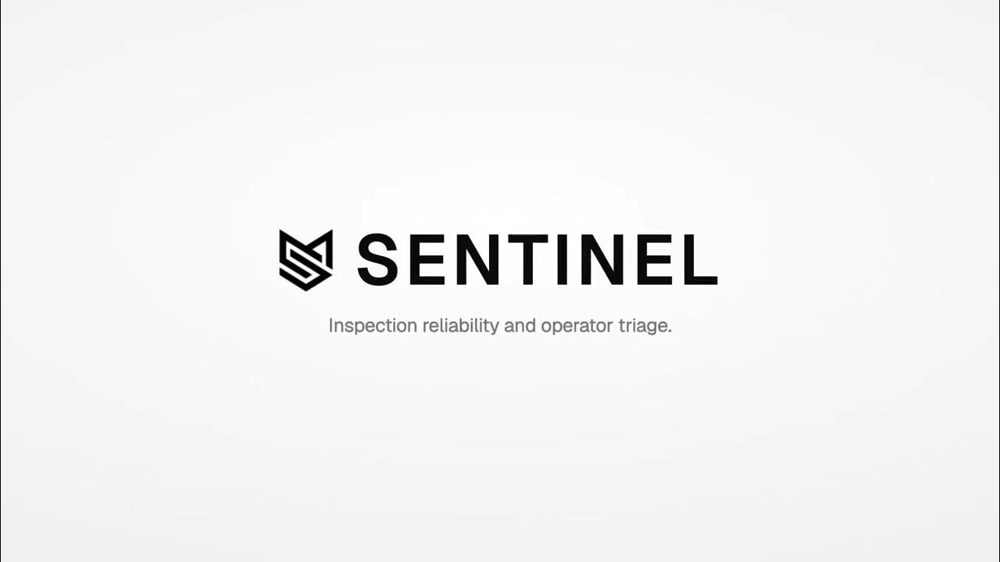
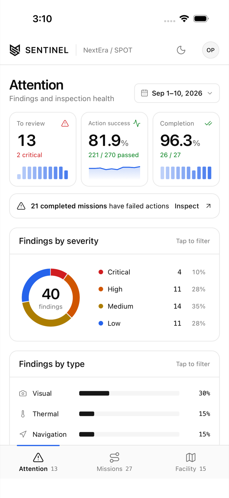
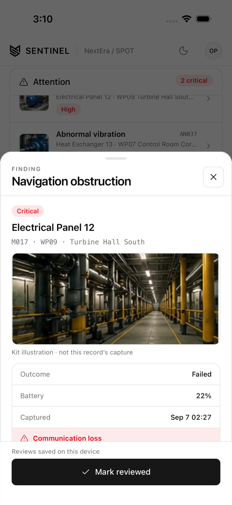
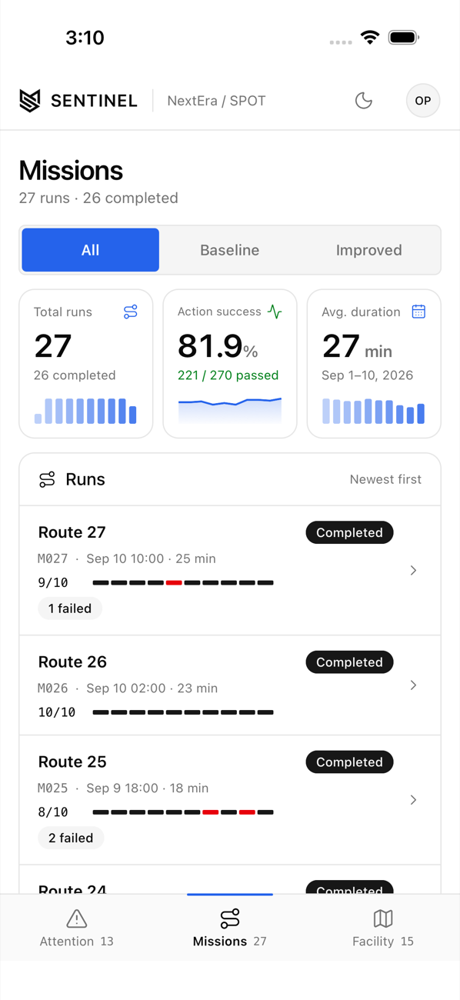
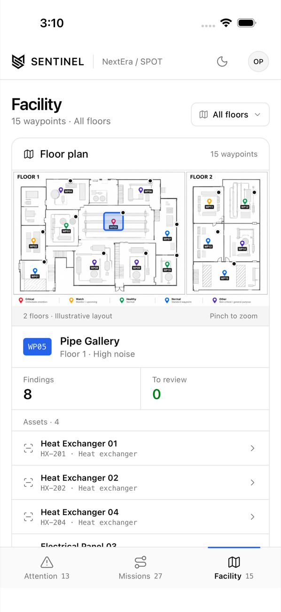
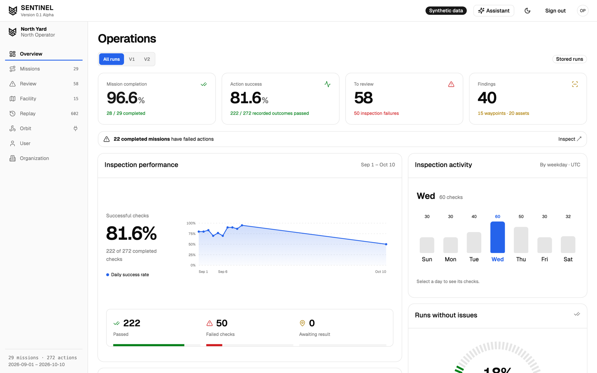
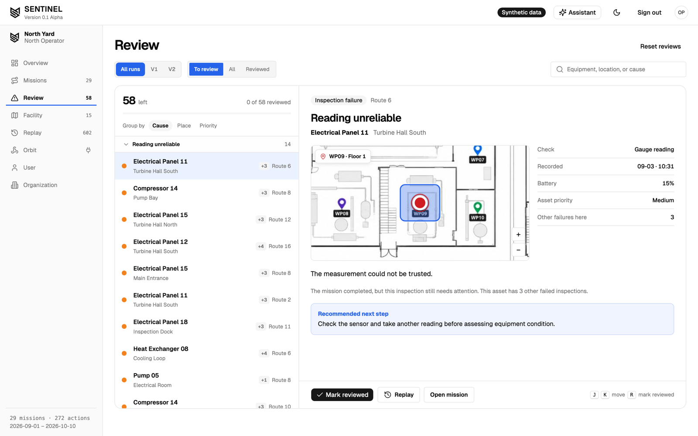
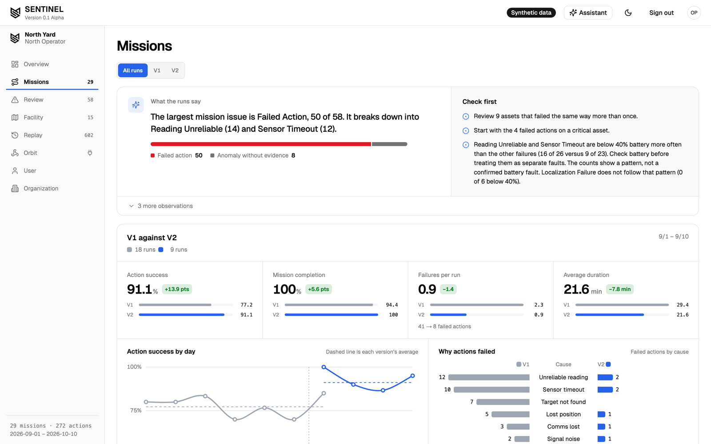

# SENTINEL

SENTINEL is an inspection triage platform built for the NextEra SPOT challenge at KnightHacks. It takes inspection data from Boston Dynamics Spot robots (through Orbit or direct uploads), checks each reading against a set of rules, and gives operators a short list of findings that actually need a human to look at them. It ships as a web dashboard, an iPhone app, and a FastAPI backend.

## Demo

[](https://youtu.be/EhBOlE83Gbk)

[Watch the demo on YouTube](https://youtu.be/EhBOlE83Gbk)

## What it does

- **Attention queue**: ranks findings by severity so operators review the critical ones first. Each finding opens into its evidence: the asset, waypoint, readings, battery, and capture time.
- **Missions**: lists every robot run and separates mission completion from action success, so a mission that finished but had failed inspections still gets flagged. The web dashboard also compares mission versions (V1 against V2) and breaks down why actions failed.
- **Review** (web): works through flagged inspections one at a time, grouped by cause, place, or priority, with the waypoint shown on the floor plan and a recommended next step.
- **Facility map**: shows the 15 inspection waypoints on the floor plan with their finding counts. The map supports pinch to zoom and pan on mobile.
- **Rules engine**: compares each reading to that asset's own history and to a common sense ceiling for its asset type, then labels it as an inspection failure, an equipment finding, or a potential anomaly.
- **Orbit integration**: organizations connect their Orbit account and receive inspection data through a webhook.
- **Accounts**: operators sign in under an organization. Reviews are saved per device.
- **Replay** (web): steps through the recorded event stream from the robot runs.

## Screenshots

### iPhone app

| Attention | Finding evidence | Missions | Facility |
| :---: | :---: | :---: | :---: |
|  |  |  |  |

### Web dashboard

**Operations overview**



**Review**



**Missions**



## Tech stack

| Part | Path | Built with |
| --- | --- | --- |
| Web dashboard | `SENTINEL-web-frontend` | Next.js 16, React 19, TypeScript, Tailwind CSS 4, shadcn/ui, ECharts |
| iPhone app | `SENTINEL-mobile-frontend` | Expo SDK 57, React Native, TypeScript, Reanimated, Gesture Handler, AsyncStorage |
| Shared code | `packages/core` | TypeScript records, fixtures, metrics, triage selectors, and a typed API client |
| API | `api` | Python, FastAPI, Uvicorn, psycopg |
| Database | `database` | Postgres on Databricks Lakebase (SQL migrations `001` to `012`) |
| Testing | | Vitest, Jest Expo, React Native Testing Library, pytest |

## Running locally

Requires Node.js 24 or newer and Python 3.12. Install JavaScript dependencies from the repository root.

```bash
npm ci
npm run dev:web      # web app at http://localhost:3000
npm run dev:mobile   # Expo dev server for the iPhone app
```

Start the API in a separate terminal:

```bash
cd api
pip install -r requirements.txt
uvicorn app.main:app --reload   # http://localhost:8000
```

Without an API URL, the mobile app runs on the bundled challenge data. Set `EXPO_PUBLIC_API_URL` in `SENTINEL-mobile-frontend/.env.local` to point it at the API. Native build steps for the iPhone app are in the [mobile README](SENTINEL-mobile-frontend/README.md).

Regenerate the fixtures from the challenge kit with `npm run data:import`.

## Notes

- All data comes from the synthetic dataset supplied in the challenge kit.
- Inspection images are illustrations from the kit, not the actual capture for each record.
